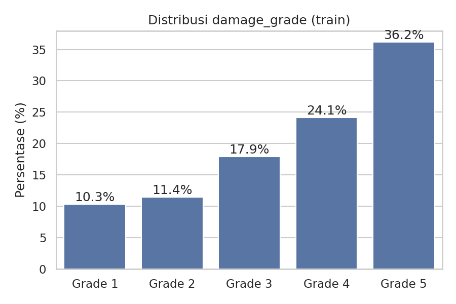
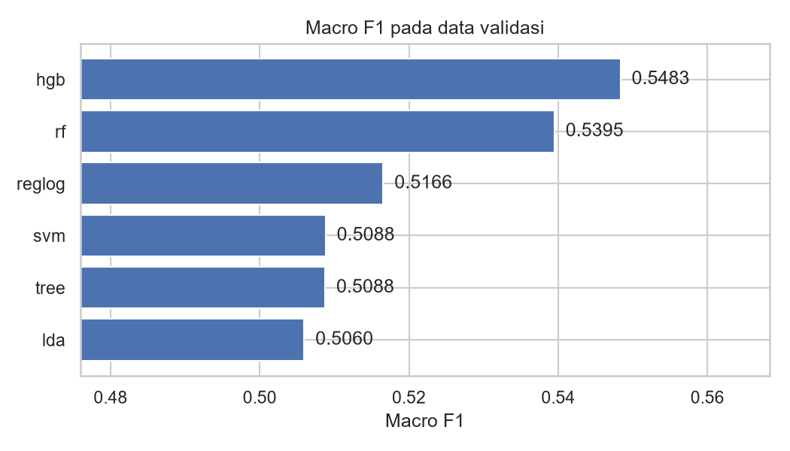
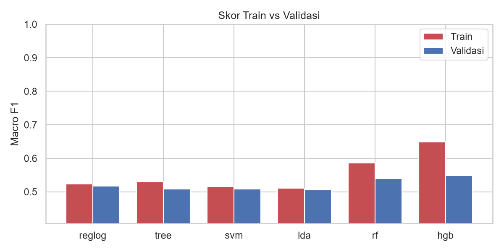
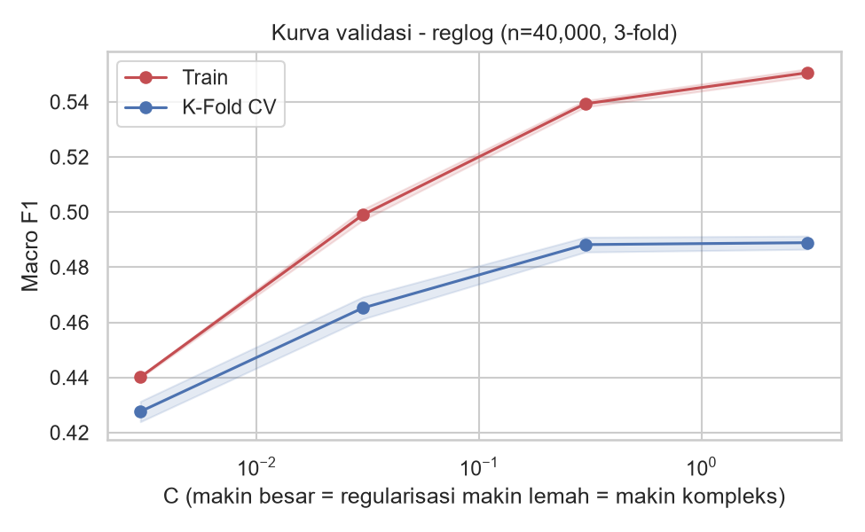
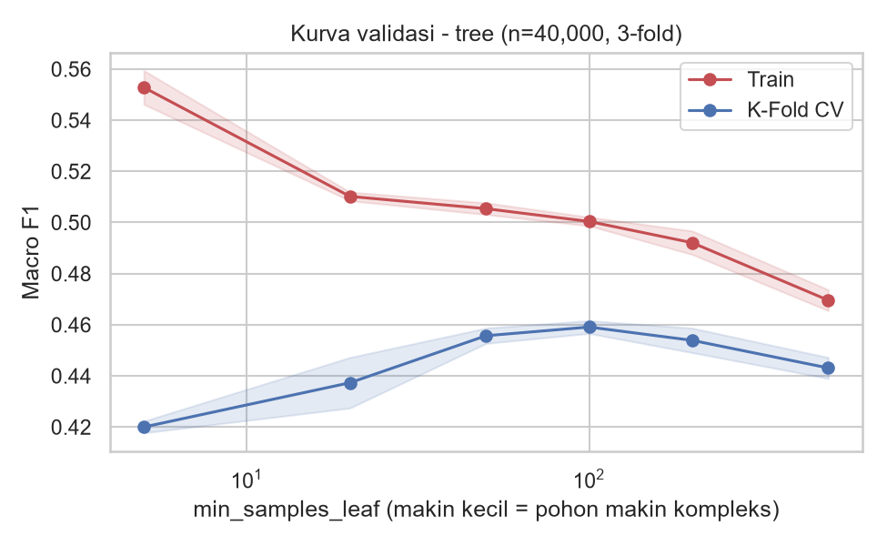
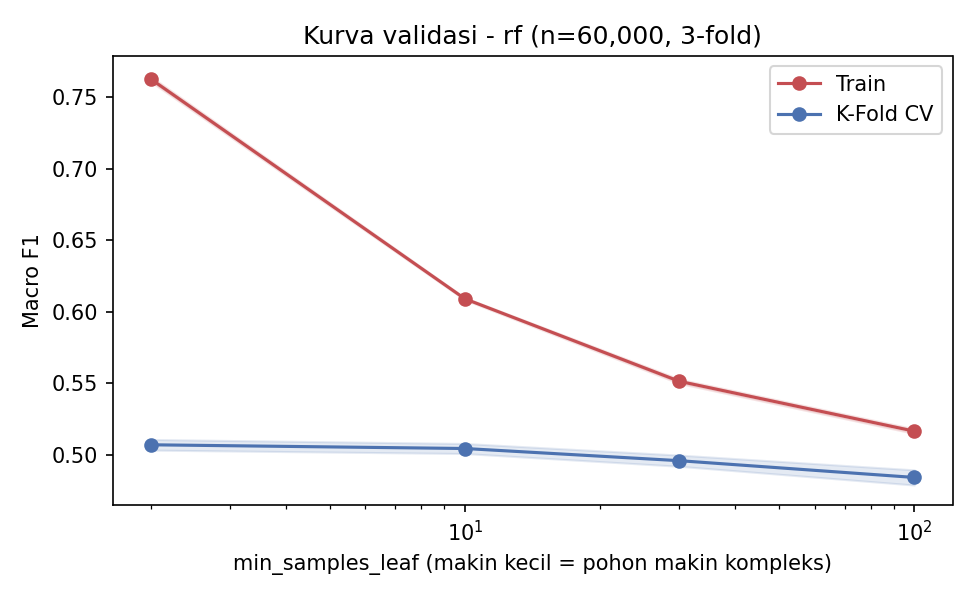
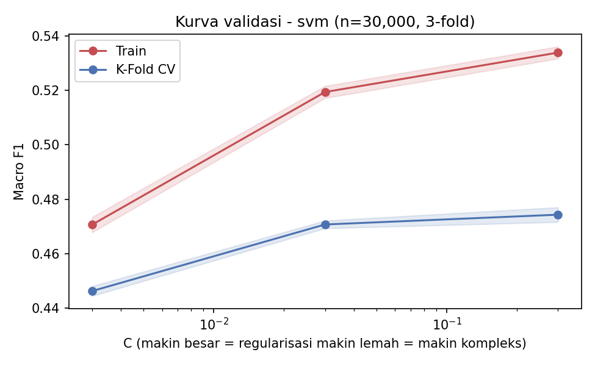
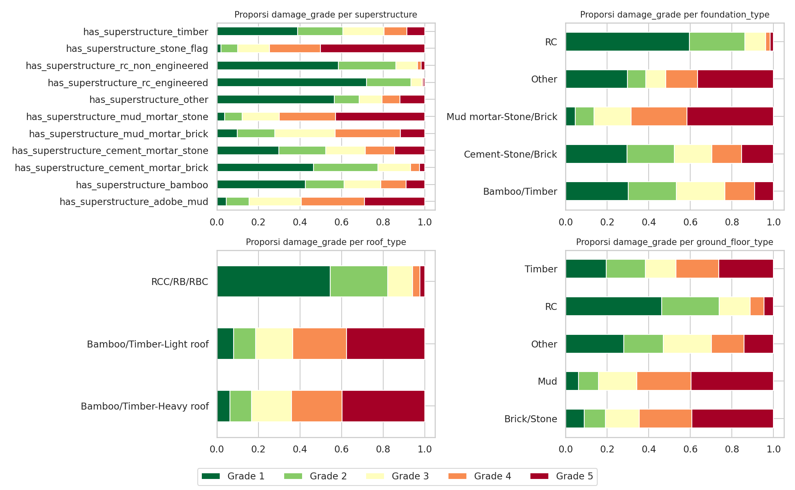

# Structural Damage Classification

Tugas 1 Supervised Machine Learning 2026: memprediksi tingkat kerusakan bangunan
(`damage_grade` 1-5) pasca gempa Gorkha, Nepal (25 April 2015) dari karakteristik struktural bangunan.

- **Kompetisi:** https://www.kaggle.com/t/a9196b92680b4492aeb06aeaee94f654
- **Metrik:** Macro F1-Score
- **4 metode tugas:** Analisis Diskriminan (LDA), Regresi Logistik, SVM, Decision Tree
- **Tambahan:** Random Forest (pengembangan Decision Tree) dan Gradient Boosting

---

## Struktur Repository

```
structural-damage-classification/
├── README.md
├── .gitignore
├── requirements.txt
├── data/                          # dataset (tidak di-commit, lihat cara unduh)
│   └── .gitkeep
├── notebooks/
│   ├── 01_eda.ipynb               # eksplorasi data
│   ├── 02_modeling.ipynb          # 4 metode, CV, diagnosis overfit/underfit, model selection
│   └── 03_submission.ipynb        # membuat file submission
├── scripts/
│   ├── __init__.py
│   ├── preprocess.py              # load data + Pipeline / ColumnTransformer
│   ├── feature_engineering.py     # fitur turunan, silang kategori, agregat wilayah
│   ├── models.py                  # pipeline + grid parameter tiap metode
│   ├── evaluation.py              # penyesuaian kelas, Train vs Validasi, kurva validasi
│   ├── model_selection.py         # K-Fold CV, Grid Search, Random Search
│   ├── train.py
│   └── predict.py
├── models/                        # model tersimpan (.pkl)
├── submissions/                   # file submission per metode
└── reports/
    ├── model_selection_*.json     # hasil Grid vs Random Search
    ├── train_summary_*.json       # skor validasi, Train vs Validasi, penyesuaian kelas
    ├── validation_curve_*.json    # data kurva validasi
    └── figures/                   # gambar hasil analisis
```

---

## Cara Mengunduh Data

Dataset **tidak disimpan di repo** (`train.csv` ~97 MB).

**Manual:** buka halaman kompetisi, tab **Data**, **Download All**, ekstrak, lalu taruh
`train.csv`, `test.csv`, `sample_submission.csv`, `metadata.csv` di folder `data/`
(pastikan sudah klik *I Understand and Accept* di tab Rules).

**Kaggle API:**
```bash
kaggle competitions download -c structural-damage-classification
unzip structural-damage-classification.zip -d data/
```

---

## Cara Menjalankan

```bash
# 1. Environment
python -m venv venv
venv\Scripts\activate            # Windows  (Mac/Linux: source venv/bin/activate)
pip install -r requirements.txt

# 2. Latih model (dari root repo). Pilihan --model: reglog | tree | svm | lda | rf | hgb
python -m scripts.train --model reglog --reweight

# 3. Buat submission  ->  submissions/submission_<model>.csv
python -m scripts.predict --model reglog

# 4. (Opsional) model selection: K-Fold CV + Grid vs Random Search
python -m scripts.model_selection --model tree --cv 5 --tune_size 100000

# 5. (Opsional) kurva validasi untuk diagnosis overfit/underfit
python -m scripts.evaluation --model tree --n 60000
```

- `--reweight`: mencari penyesuaian skor per kelas untuk memaksimalkan Macro F1.
- `--use_best`: memakai parameter terbaik dari `reports/model_selection_<model>.json` (dipakai untuk SVM).
- Format submission: `building_id,damage_grade` dengan **angka 1-5**.
- Model `rf` berukuran ~250 MB sehingga **tidak di-commit** (ada di `.gitignore`); buat ulang dengan
  `python -m scripts.train --model rf --reweight`.
- Jalankan notebook berurutan: `01_eda` -> `02_modeling` -> `03_submission`. Di `02_modeling`,
  isi `SAMPLE_SIZE` untuk uji cepat (SVM di data penuh bisa belasan menit).

---

## Dataset

| Item | Keterangan |
|---|---|
| Train / Test | 533.465 / 228.629 bangunan |
| Target | `damage_grade` 1-5 (di data train berupa teks `Grade 1`-`Grade 5`) |
| Numerik | jumlah lantai, umur, luas dasar, tinggi |
| Kategorikal | kondisi lahan, fondasi, atap, lantai dasar, lantai lain, posisi, bentuk denah, material struktur |
| Wilayah | `district_id`, `vdcmun_id`, `ward_id` |

Distribusi kelas tidak seimbang: Grade 5 sekitar 36%, Grade 4 24%, Grade 3 18%, Grade 2 11%, Grade 1 10%.



---

## Workflow Analisis dan Preprocessing

Mengikuti alur materi asisten (*General ML Workflow*):

1. **Quick EDA** (`01_eda.ipynb`): cek missing value (tidak ada), duplikat, statistik deskriptif, outlier,
   hubungan fitur dengan target, noise label. `building_id` dibuang karena hanya identitas.
2. **Split** train/validasi 80/20 dengan `stratify=y`, `random_state=42`.
3. **Preprocessing dalam `Pipeline` + `ColumnTransformer`** (`scripts/preprocess.py`), sehingga imputer,
   scaler, dan encoder hanya belajar dari data train (tidak ada data leakage):
   - Numerik: `SimpleImputer(median)` -> `StandardScaler` (median karena luas dan umur sangat miring).
   - Kategorikal dan wilayah: `SimpleImputer(most_frequent)` -> `OneHotEncoder`
     (kategori langka digabung, kategori baru diabaikan).
   - `age_building = 999` (umur tidak diketahui, 0,4% data) menjadi NaN + flag `age_unknown`.
   - Feature engineering (`scripts/feature_engineering.py`): luas dan tinggi per lantai, log luas,
     kolom silang kategorikal (*feature crossing*), binning kuantil, dan agregat per wilayah.
   - `TargetEncoder` multiclass untuk `vdcmun_id` dan `ward_id` (cross-fitting 5-fold, tanpa leakage).
4. **Pipeline model** dengan dua langkah, `prep` -> `algo` (nama sama seperti materi asisten).
5. **Evaluasi** Macro F1, diagnosis overfit/underfit (Train vs Validasi dan kurva validasi).
6. **Model selection**: Stratified K-Fold CV, Grid Search, dan Random Search.
7. **Penyesuaian bobot kelas** untuk Macro F1 (`--reweight`), lalu fit ulang di seluruh data train.

**Keputusan preprocessing berbasis uji:**
- *Outlier*: clipping persentil 1%-99% pada data train tidak mengubah skor (Regresi Logistik 0.5120 -> 0.5122,
  LDA 0.5060 -> 0.5060), jadi tidak dipakai. Penghapusan outlier ala IQR (materi Diskriminan) juga tidak bisa
  diterapkan pada data test. Dampak ekor panjang diredam oleh `log_plinth_area` dan model pohon yang tahan outlier.
- *Duplikat*: baris dengan profil sama adalah bangunan berbeda (`building_id` unik), bukan kesalahan input, sehingga tidak dibuang.

| Metode | Preprocessing khusus | Algoritma |
|---|---|---|
| Regresi Logistik | one-hot + silang kategori + binning + agregat wilayah, scaling | `LogisticRegression(C=1, class_weight='balanced')` |
| Decision Tree | one-hot + TargetEncoder wilayah, tanpa scaling | `DecisionTreeClassifier(entropy, min_samples_leaf=100, balanced)` |
| SVM | sama dengan Regresi Logistik | `LinearSVC(C=0.3, dual=False, balanced)` |
| Analisis Diskriminan | one-hot dense + TargetEncoder + agregat wilayah | `LinearDiscriminantAnalysis(priors seragam)` |
| Random Forest | ordinal + TargetEncoder + agregat (42 kolom dense) | `RandomForestClassifier(100 pohon, min_samples_leaf=20, balanced_subsample)` |
| Gradient Boosting | sama dengan Random Forest | `HistGradientBoostingClassifier(300 iter, 127 daun, L2=1)` |

---

## Hasil

Macro F1 pada data validasi (80/20) untuk model final. *Estimasi gain* adalah kenaikan dari penyesuaian bobot
kelas yang diukur jujur (dicari di separuh validasi, diuji di separuh lain), jadi belum termasuk di kolom skor.

| Metode | Macro F1 validasi | Estimasi gain penyesuaian kelas | Public Score |
|---|---|---|---|
| Regresi Logistik | 0.5166 | +0.0046 | **0.51701** |
| Decision Tree | 0.5088 | +0.0094 | **0.52179** |
| SVM (linear) | 0.5095 | +0.0071 | **0.51649** | 
| Analisis Diskriminan | 0.5060 | +0.0014 | _isi_ | 
| *Random Forest (tambahan)* | 0.5391 | +0.0091 | **0.55217** |
| *Gradient Boosting (tambahan)* | 0.5484 | +0.0049 | **0.55865** |



---

## Diagnosis Overfitting dan Underfitting

### Skor Train vs Validasi

Skor train dibandingkan dengan skor validasi (skor train dihitung pada 100 ribu baris
train). Ambang heuristik: gap > 0.10 = indikasi overfit, gap < 0.03 = tidak overfit. Untuk model ber-TargetEncoder,
skor train sedikit terlalu optimistis, sehingga gap adalah batas atas.

| Metode | Train F1 | Validasi F1 | Gap | Kesimpulan |
|---|---|---|---|---|
| Regresi Logistik | 0.5240 | 0.5166 | +0.0073 | gap kecil (tidak overfit) |
| Decision Tree | 0.5300 | 0.5088 | +0.0212 | gap kecil (tidak overfit) |
| SVM (linear) | 0.5171 | 0.5095 | +0.0076 | gap kecil (tidak overfit) |
| Analisis Diskriminan | 0.5109 | 0.5060 | +0.0049 | gap kecil (tidak overfit) |
| *Random Forest (tambahan)* | 0.5858 | 0.5391 | +0.0467 | gap sedang |
| *Gradient Boosting (tambahan)* | 0.6476 | 0.5484 | +0.0992 | gap sedang |



### Kurva validasi

Skor train vs K-Fold CV terhadap parameter pengatur kompleksitas model:

**Regresi Logistik** (parameter `C`, n=60,000, 3-fold)

| C | Train | CV | Gap |
|---|---|---|---|
| 0.003 | 0.4479 | 0.4387 | +0.0092 |
| 0.03 | 0.5063 | 0.4790 | +0.0273 |
| 0.3 | 0.5399 | 0.4983 | +0.0416 |
| 3.0 | 0.5469 | 0.4974 | +0.0495 |



**Decision Tree** (parameter `min_samples_leaf`, n=60,000, 3-fold)

| min_samples_leaf | Train | CV | Gap |
|---|---|---|---|
| 5 | 0.5569 | 0.4236 | +0.1333 |
| 20 | 0.5156 | 0.4527 | +0.0629 |
| 50 | 0.5065 | 0.4626 | +0.0439 |
| 100 | 0.5032 | 0.4709 | +0.0323 |
| 200 | 0.4955 | 0.4688 | +0.0267 |
| 500 | 0.4778 | 0.4530 | +0.0248 |



**Random Forest (tambahan)** (parameter `min_samples_leaf`, n=60,000, 3-fold)

| min_samples_leaf | Train | CV | Gap |
|---|---|---|---|
| 2 | 0.7625 | 0.5072 | +0.2553 |
| 10 | 0.6091 | 0.5046 | +0.1045 |
| 30 | 0.5515 | 0.4961 | +0.0554 |
| 100 | 0.5167 | 0.4844 | +0.0323 |



**SVM (linear)** (parameter `C`, n=30,000, 3-fold)

| C | Train | CV | Gap |
|---|---|---|---|
| 0.003 | 0.4706 | 0.4462 | +0.0244 |
| 0.03 | 0.5194 | 0.4707 | +0.0487 |
| 0.3 | 0.5339 | 0.4743 | +0.0596 |



### Kesimpulan diagnosis

- **Empat metode tugas tidak overfit**: gap Train-Validasi kecil (di bawah 0.03). Skor validasinya lebih rendah
  daripada model non-linear, sehingga model linear dan LDA lebih tepat dibaca sebagai **terbatas kapasitasnya
  (bias tinggi, underfit ringan)**, bukan kelebihan varians. Pohon yang terlalu dangkal juga jelas underfit
  (`max_depth=8` hanya 0.39).
- **Parameter berada di titik yang seimbang.** Regresi Logistik: `C` terlalu kecil underfit (train dan CV sama-sama rendah),
  `C` besar hanya melebarkan gap tanpa menaikkan CV, sehingga `C=1` ada di dataran terbaik. Decision Tree:
  `min_samples_leaf` kecil overfit (gap besar), terlalu besar underfit, dan CV tertinggi ada di sekitar 100.
- **Random Forest** relatif tahan overfit: skor CV justru meningkat ketika pohon dibuat lebih kompleks
  (`min_samples_leaf` makin kecil), meski gap train-CV membesar. Nilai 20 dipilih sebagai kompromi karena
  `min_samples_leaf` yang lebih kecil membuat file model melewati batas 100 MB GitHub. Ada potensi kenaikan CV
  kecil bila pohon dibuat lebih dalam.
- **Gradient Boosting** punya gap terbesar (mendekati ambang 0.10) tetapi skor validasinya tertinggi; perlu
  diwaspadai sebagai model yang paling rentan overfit. Ia bukan salah satu dari empat metode tugas.
- Keterbatasan: kurva validasi dihitung pada subsampel (30-60 ribu baris), sehingga titik optimum
  `min_samples_leaf` di data penuh bisa bergeser.

---

## Model Selection (Grid Search vs Random Search)

Skor = Macro F1 rata-rata Stratified K-Fold CV pada subsampel stratified (scoring `f1_macro`). Karena subsampel,
angkanya lebih rendah daripada skor validasi di atas dan tidak boleh dibandingkan langsung.

| Metode | Data / fold | CV default (± std) | Grid Search | Random Search | Parameter terpilih |
|---|---|---|---|---|---|
| Regresi Logistik | 40k / 5 | 0.4943 ± 0.0033 | 0.4943 (180 dtk, 30 fit) | 0.4935 (88 dtk, 15 fit) | C=1.0 |
| Decision Tree | 100k / 5 | 0.4765 ± 0.0026 | 0.4812 (572 dtk, 80 fit) | 0.4812 (300 dtk, 40 fit) | entropy, max_depth=None, min_samples_leaf=100 |
| SVM (linear) | 30k / 3 | 0.4728 ± 0.0015 | 0.4743 (63 dtk, 15 fit) | 0.4743 (42 dtk, 9 fit) | C=0.3 |
| Analisis Diskriminan | 100k / 5 | 0.5009 ± 0.0028 | 0.5009 (67 dtk, 25 fit) | 0.5003 (36 dtk, 15 fit) | solver=svd |

Pencarian dijalankan sebelum langkah pipeline diganti namanya menjadi `prep`/`algo`; fitur yang dihasilkan tidak berubah,
sehingga hasilnya tetap berlaku (kunci parameter pada file JSON sudah disesuaikan).

---

## Interpretasi


**1. Perbandingan metode.** Keempat metode tugas berada di rentang sempit (Macro F1 0.5060-0.5166):
selisihnya sekitar 0.011, atau kurang lebih 3 kali simpangan baku antar-fold K-Fold (sekitar 0.003-0.004).
Regresi Logistik sedikit unggul. Random Forest (0.5391) dan Gradient Boosting (0.5484)
jelas lebih tinggi karena mampu menangkap interaksi non-linear antar fitur (misalnya material x umur x jumlah lantai),
sedangkan model linear dan satu pohon tidak. Random Forest jauh melampaui satu Decision Tree (0.5088)
karena rata-rata banyak pohon menurunkan varians satu pohon.

**2. Kelas yang sulit.** Grade 2 dan Grade 3 paling sulit diprediksi (F1 kira-kira 0.33-0.42 pada berbagai model) dan paling
sering tertukar dengan kelas di sebelahnya; Grade 5 paling mudah (F1 sekitar 0.70-0.72). Tingkat kerusakan bersifat berurutan
dan batas antar kelas tengah kabur (confusion matrix ada di `02_modeling.ipynb`).

**3. Data berisik.** Sekitar 10,6% baris memiliki profil fitur yang persis sama dengan baris lain, dan sekitar 47% dari
kelompok itu berisi label yang berbeda-beda. Ada batas atas performa yang tidak bisa dilewati model apa pun dengan fitur
yang tersedia, dan ini menjelaskan mengapa semua skor berkumpul di sekitar 0.50-0.55.

**4. Fitur yang berpengaruh.** Material bangunan sangat menentukan: bangunan beton bertulang (RC) didominasi Grade 1,
sedangkan bangunan batu/bata dengan mortar lumpur, adobe, dan fondasi *mud mortar-stone/brick* didominasi Grade 4-5
(gambar di bawah). **Lokasi** juga sangat penting: ketika fitur wilayah dibuang, Macro F1 Regresi Logistik dan LDA turun
dari sekitar 0.50-0.51 menjadi sekitar 0.41. _isi: tambahkan fitur teratas dari `feature_importance_rf.png` setelah menjalankan notebook 02._



**5. Class imbalance.** `class_weight='balanced'` membantu kelas minoritas, tetapi membuat model terlalu sering menebak
Grade 1 (recall tinggi, presisi rendah). Penyesuaian bobot kelas menurunkan skor Grade 1 dan menambah Macro F1
sekitar +0.001 sampai +0.009 tergantung model.

**6. Encoding wilayah.** `TargetEncoder` dan fitur agregat wilayah menaikkan Gradient Boosting (sekitar +0.02) dan sedikit
Decision Tree (+0.007), tetapi tidak membantu model linear, karena one-hot `ward_id` sudah memberi tiap wilayah koefisien sendiri.

**7. Model selection.** Random Search menemukan skor yang sama atau hampir sama dengan Grid Search dalam waktu sekitar
separuhnya. Kenaikan akibat tuning kecil dan umumnya masih dalam satu simpangan baku (Regresi Logistik dan LDA sudah optimal
pada parameter default). Parameter terbaik dari subsampel belum tentu terbaik di data penuh: pada Decision Tree, parameter
hasil pencarian (0.5088) sedikit di bawah parameter awal (0.5106) di data penuh, dengan gain penyesuaian kelas yang lebih besar.

**8. Validasi vs Public Score.** Skor validasi Regresi Logistik (0.5166) dan Public Score (0.51701)
sangat dekat, jadi validasi lokal dapat dipercaya. _isi: bandingkan dengan Private Score setelah kompetisi selesai._

**9. Keterbatasan dan ide perbaikan.** SVM memakai `LinearSVC` karena SVM kernel tidak praktis untuk >500 ribu baris. LDA
mengasumsikan fitur berdistribusi normal, yang dilanggar oleh fitur one-hot. Pencarian parameter dan kurva validasi memakai
subsampel. Perbaikan potensial: fitur interaksi yang lebih kaya, target encoding bertingkat, dan ensemble beberapa model.

---

## Catatan

- Seed acak `random_state=42` dipakai di seluruh pipeline.
- Model tersimpan memakai `joblib` (`models/pipeline_model_<metode>.pkl`):
  ```python
  import joblib
  model = joblib.load("models/pipeline_model_reglog.pkl")
  ```
